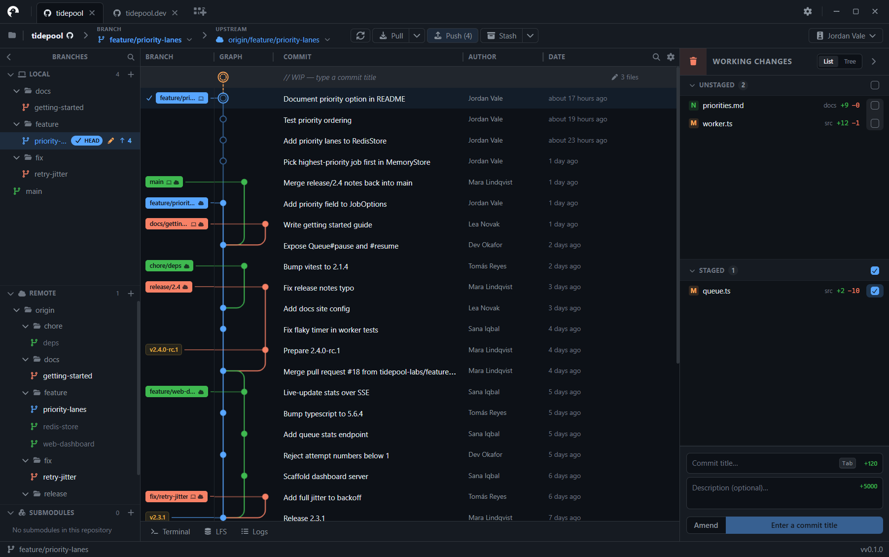
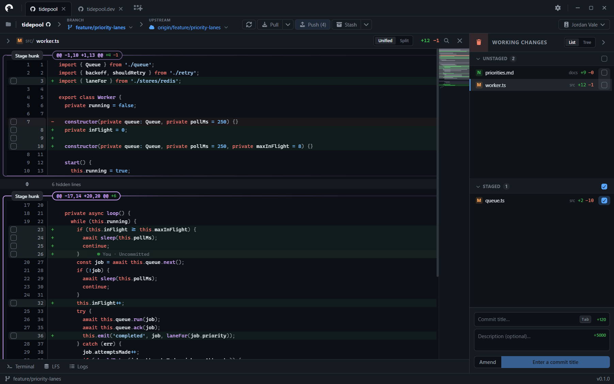
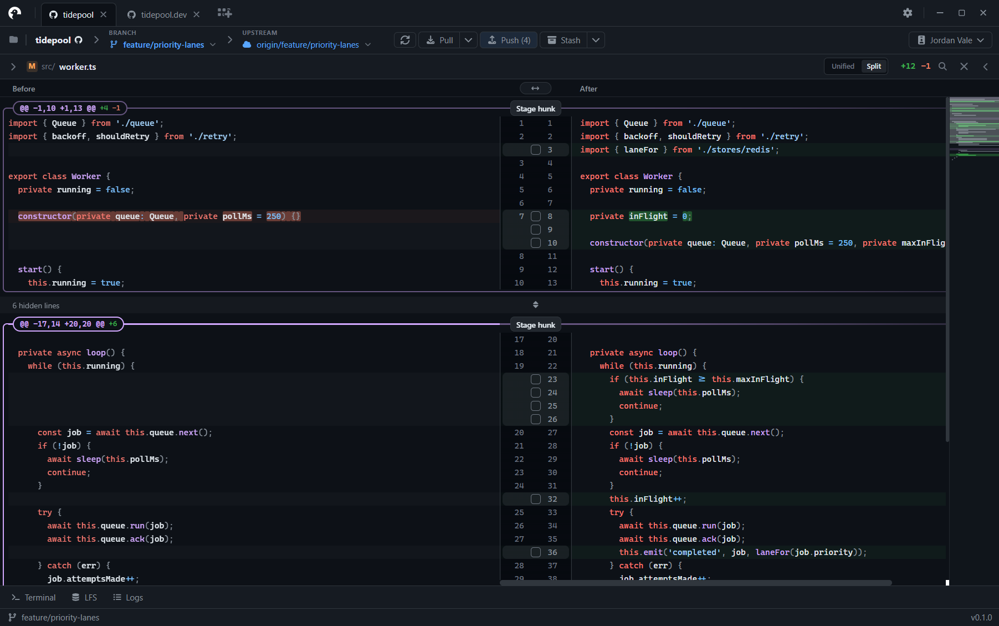
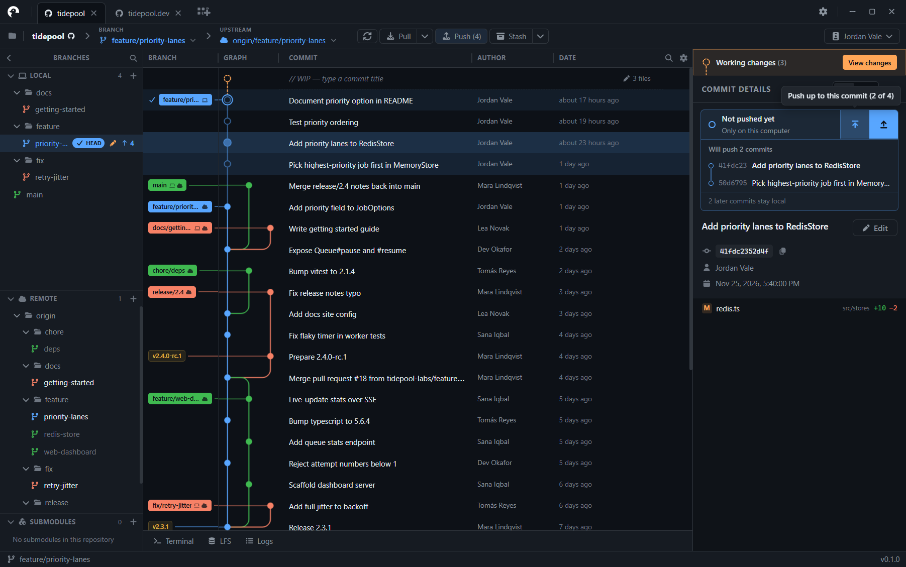
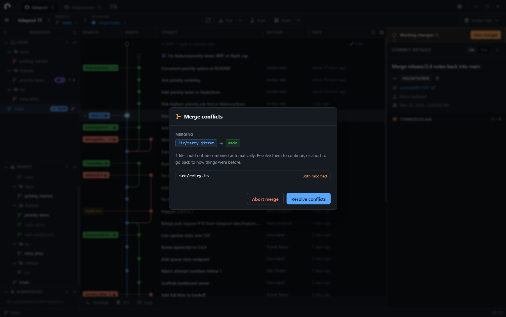
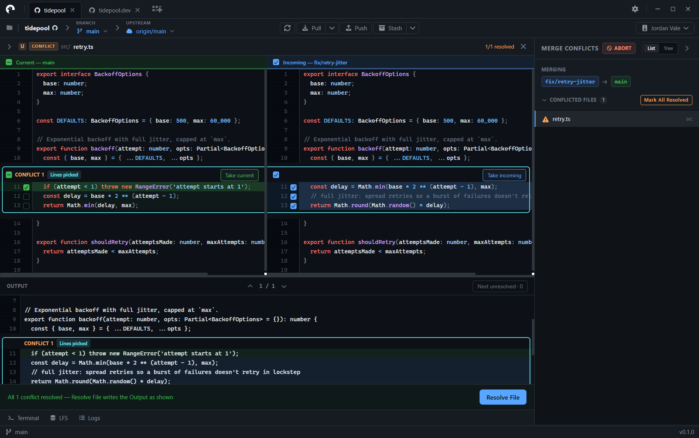
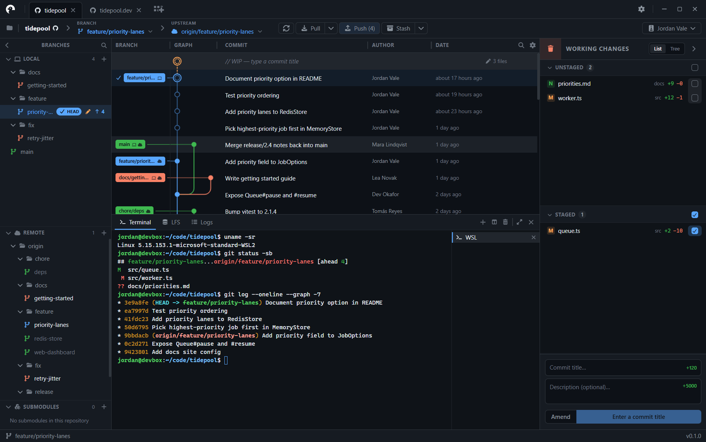
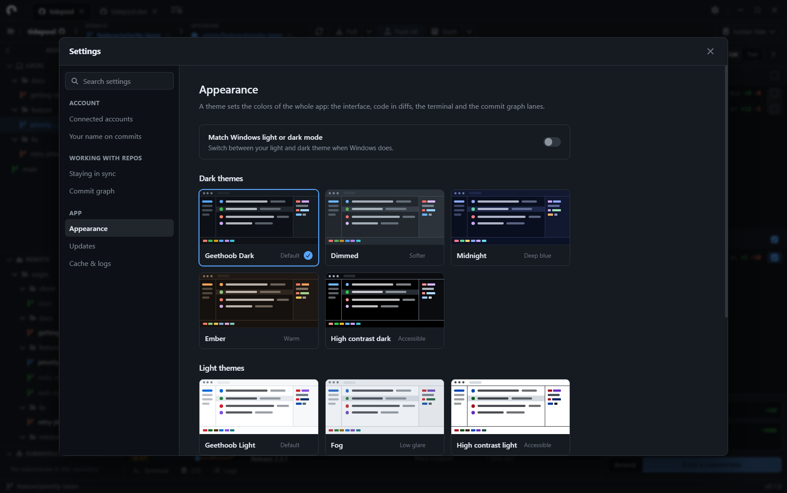
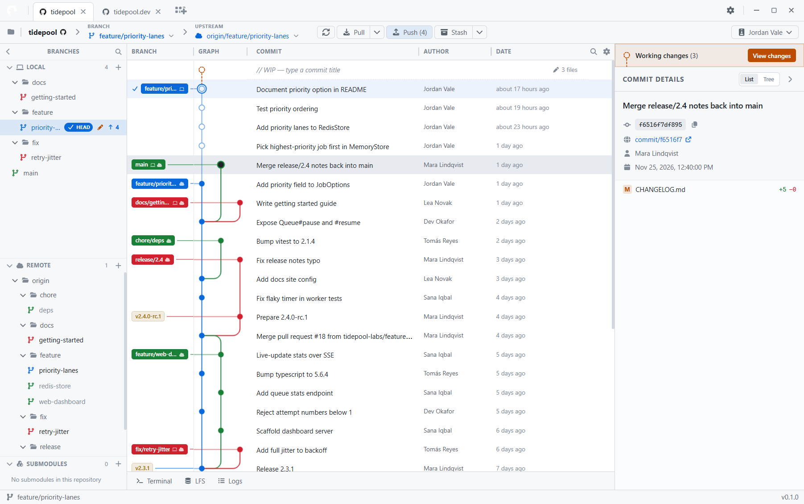

# Geethoob Desktop

A UX oriented desktop client for Git.

**[Download for Windows](https://github.com/n-ubo/geethoob-desktop-releases/releases/latest)**

## Features

### Diffs

Unified or split. Stage hunks or single lines.

  
  

### Push up to a commit

Push only part of your unpushed work.

### Merge conflicts

Take a side, or pick lines from both.

  
  

### Terminal, with WSL support

Repos inside WSL just work, terminal included.

### Themes

Built-in light and dark themes, or write your own.

  
  

## Download

Get the latest installer from the [releases page](https://github.com/n-ubo/geethoob-desktop-releases/releases/latest). It's the file named `geethoob-desktop-setup-<version>.exe`.

Geethoob Desktop currently runs on Windows (64-bit).

## Installing

Run the installer. It installs for your user account only and doesn't need admin rights.

The installer isn't code-signed yet, so Windows SmartScreen may warn you the first time. Click **More info**, then **Run anyway**.

## License

Free to use, including at work, and to share and modify. Selling it, or charging for a product or service based on it, is not allowed. See [LICENSE](LICENSE) (MIT with the Commons Clause).
